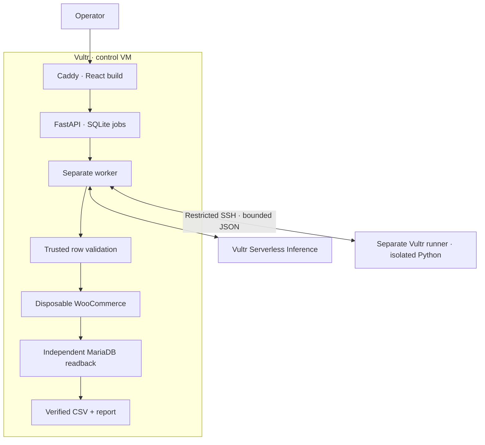

<div align="center">



<br />

**Rehearse supplier catalog changes. Release a file backed by evidence.**

For WooCommerce operators who need to update prices and stock without gambling on
a supplier spreadsheet. Confirm the meaning, rehearse in a disposable store, and
download only independently verified changes.

<a href="https://95.179.218.142.sslip.io"></a>
<a href="docs/live-deployment.md"></a>
<a href="#run-locally"></a>

<br />

[](https://github.com/Asembris/ShelfReady/actions/workflows/ci.yml)
[](https://github.com/Asembris/ShelfReady/actions/workflows/security.yml)
[](docs/live-deployment.md)
[](#what-has-actually-been-verified)
[](#what-has-actually-been-verified)
[](LICENSE)
[](https://lablab.ai/ai-hackathons/vultr-hackathon)


</div>

The hosted demo requires a private invite from the owner and accepts only its two
provided synthetic CSVs. It is a bounded judging deployment, last verified on
**November 5, 2026**, with an operating review on **November 7**. Availability is
temporary; the local setup below remains reproducible.

Optional model interpretation sends the entered intent text to Vultr Serverless
Inference. Use synthetic examples and leave credentials and personal data out of
that field.

## The 30-second version

A supplier file is a proposal, not permission to change your catalog.

ShelfReady pairs your current WooCommerce CSV with a supplier update. You approve
the columns and same-currency price/stock replacement. Vultr generates a Python
transformation; a separate runner executes it in isolation. Trusted code checks
every row before a native WooCommerce import, then reads MariaDB independently
to verify what actually persisted. Only then do downloads unlock.

**The model writes the transformation. It cannot authorize a change or certify
its own result.** Nothing is published to your production store.

## Walk through a real rehearsal

1. **Bring two files.** In the invited demo, download the
   [approved synthetic pair](https://95.179.218.142.sslip.io/demo/index.html).
   Upload them as **Baseline WooCommerce CSV** and **Supplier CSV**.
2. **Make the meaning explicit.** Select **Upload and review mappings**, inspect
   source values, and confirm every required column. Changing a mapping clears
   consent. Optional model interpretation is a proposal you must review.
3. **Give permission.** Check the mapping/intent confirmation and select
   **Confirm and rehearse**. Execution cannot begin before this step.
4. **Wait for evidence.** A separate worker runs the bounded transformation,
   imports resolved rows into disposable WooCommerce, checks independent SQL
   readback, and cleans up. The interface never invents percentage progress.
5. **Take the verified file.** Use **Download verified CSV** and
   **Download change report**. Partial results list held rows and their reasons;
   zero resolved rows or a verification/cleanup failure releases no CSV.

The November 5 public run persisted these synthetic updates and downloaded them
through the real interface:

| Exact SKU | Baseline price / stock | Verified price / stock |
| --------- | ---------------------- | ---------------------- |
| `00017`   | `12.30` / `4`          | `13.55` / `7`          |
| `A-2`     | `0.10` / `0`           | `1.35` / `2`           |

Leading zeros stayed intact. Disposable product IDs and supported unchanged
fields were preserved. A separate negative control held both unknown identifiers
and denied downloads, without calling the model.

## What has actually been verified

| Evidence lane                            | Recorded result                                                                   | What it establishes                                                                                 |
| ---------------------------------------- | --------------------------------------------------------------------------------- | --------------------------------------------------------------------------------------------------- |
| **Live Vultr deployment**                | 3 public Playwright tests passed; one model request, 835 tokens                   | HTTPS/auth, actual upload-to-download, remote execution, native import, independent SQL and cleanup |
| **Live negative / containment controls** | Held rows; download denial; network/write denial; enforced timeout and memory cap | Tested fail-closed behavior and the separate runner boundary                                        |
| **Public frontend**                      | Desktop WebGL; 320–1440px reduced-motion layouts; keyboard and fallback checks    | The deployed cinematic UI and usable fallback surfaces on tested Chromium                           |
| **Local Python**                         | 128 tests, including 10 Docker/native tests                                       | Host regressions and real local containers; separate from cloud proof                               |
| **Offline-safe CI**                      | Python offline lane; 17 portable browser tests                                    | No live inference; portable UI tests use explicitly synthetic API responses                         |

These are dated observations, not an uptime promise or universal security claim.
Hosted CI is offline-safe and never spends inference tokens or provisions cloud
resources. [Deployment proof and limitations](docs/live-deployment.md) ·
[CI boundaries and reproduction](docs/ci-hardening.md)

## Architecture



Model and SSH credentials stay on control. Generated code executes only on the
runner. The native importer is trusted code, separate from generated Python.
Both frontend and backend are hosted on Vultr.

| Layer        | Implementation                                                                         |
| ------------ | -------------------------------------------------------------------------------------- |
| Experience   | React 19, strict TypeScript, Vite, Tailwind CSS, Three.js; locked Proof Shelf identity |
| Control      | Python 3.12, FastAPI, one separate worker, SQLite, Caddy HTTPS                         |
| Inference    | Vultr's OpenAI-compatible API; pinned `qwen3.8-27b`, explicit bounded loop             |
| Execution    | Restricted SSH dispatcher and digest-pinned Python Docker image                        |
| Rehearsal    | WooCommerce 10.3.5 native CSV importer; pinned WordPress, WP-CLI and MariaDB           |
| Verification | Independent deterministic expectations, direct SQL, pytest, Playwright, Ruff           |

## Safety is part of the workflow

- **You retain authority.** Exact SKU matching, explicit column/intent confirmation,
  no guessed currency conversion, taxes or inventory quantities.
- **Generated output is untrusted.** Independent validators reject altered,
  missing, extra or incorrectly accounted rows. Every supplier row is resolved
  or held exactly once; SKU strings and decimal precision are preserved.
- **Execution is contained.** Non-root, no network/credentials/host mounts/Docker
  socket, read-only root, 0.5 CPU, 128 MiB memory, 32 PIDs, bounded output and time.
  Docker shares the runner kernel; this is not absolute isolation.
- **An importer success message is insufficient.** SQL verifies persisted values
  and supported unchanged fields. Baseline IDs are preserved within the disposable
  store, not copied from production. Unmapped CSV fields are outside this guarantee.
- **Failure does not become success.** At most three transformation attempts;
  cleanup runs on success and failure. Failed verification or cleanup blocks export.

Inputs are bounded to 16 KiB and 100 rows per CSV. The hosted demo adds shared
Basic Auth, exact fixture allowlisting, request limits, one active job and a
persistent 30-upload quota. Downloads expire after 24 hours; expiry does not
reset the quota. [Detailed operating boundaries](docs/live-deployment.md)

## Run locally

Use **Python 3.12**, **uv**, **Node 24**, and Docker Compose v2 with a running Linux
Docker engine/cgroup v2 for native setup. Install curl for the WooCommerce
download (`curl.exe` on Windows). Docker Desktop's Linux backend is supported.
Use a dedicated development environment and stop any worker before Docker setup
or tests. For a clean setup, clone outside any directory tree containing an
existing `.env`. Dotenv can discover a parent file.

<details>
<summary><strong>Setup and three-terminal launch</strong></summary>

```sh
uv sync --frozen
npm --prefix web ci
docker pull python:3.12.12-slim-bookworm@sha256:593bd06efe90efa80dc4eee3948be7c0fde4134606dd40d8dd8dbcade98e669c
```

If package or browser downloads fail because your network uses a CA already
trusted by the operating system, run uv with `UV_NATIVE_TLS=true` and Node with
`NODE_USE_SYSTEM_CA=1` in your terminal environment. In PowerShell, use
`$env:UV_NATIVE_TLS = 'true'` and `$env:NODE_USE_SYSTEM_CA = '1'`.

Create an ignored `.env` from [.env.example](.env.example) **only if one does not
already exist**. Configure `VULTR_INFERENCE_API_KEY` locally for inference. Empty endpoint
and model fields use [the pinned configuration](config/inference.json). No
management API key or cloud provisioning is needed for local rehearsal.

Prepare the checksum-pinned plugin, disposable credentials and native store:

```sh
uv run --frozen python -m shelfready.store
```

This downloads the pinned WooCommerce package, imports/reads/resets a local test
store, then removes its disposable resources. It makes no inference request.
Start these in **three separate terminals**, from the repository root:

```sh
# 1 · loopback API
uv run --frozen uvicorn shelfready.api:app --host 127.0.0.1 --port 18765
```

```powershell
# 2 · worker, explicit local development mode (PowerShell)
$env:SHELFREADY_LOCAL_RUNNER = '1'
uv run --frozen python -m shelfready.worker
```

For a POSIX shell, use
`SHELFREADY_LOCAL_RUNNER=1 uv run --frozen python -m shelfready.worker` instead.
Local mode runs generated code in Docker on your development machine; the
deployed application requires the separate SSH runner.

```sh
# 3 · frontend
npm --prefix web run dev
```

Open **http://127.0.0.1:18766** and use [baseline.csv](fixtures/baseline.csv) and
[update.csv](fixtures/update.csv). Startup, upload and manual mapping work with
an empty key. A confirmed job that needs inference fails with a configuration
message before creating the inference client. With a valid key, confirming a
rehearsal can spend real Vultr inference tokens.

</details>

## Verify without paid integrations

After installing dependencies and `npx playwright install chromium` from `web/`:

```sh
uv run --frozen pytest -q -m "not live" --offline --strict-markers
uv run --frozen ruff check .
npm --prefix web run build
npm --prefix web run format:check
node scripts/validate_brand.mjs
node scripts/validate_showcase.mjs
npm --prefix web run test:ci
git diff --check
```

If pytest reports a permission error in its default temporary directory, append
`--basetemp=.runtime/pytest-fresh` to the pytest command. Choose a fresh scratch
path for each run, since pytest clears the specified directory.

The offline lane runs without Docker or a Vultr key. Three failure-injection
cases skip on a clean checkout until the checksum-pinned WooCommerce archive
has been downloaded by the store setup above. For the complete
Python suite, finish store setup, stop the worker and run `uv run --frozen pytest`.
GPU cinematic and real Vultr/browser journeys are separate manual lanes;
[their prerequisites and costs](docs/ci-hardening.md#explicit-manual-lanes) are
explicit. Offline passes never substitute for live integration proof.

## Scope and honest limits

CSV input, existing simple products, exact SKUs, price/stock replacement and a
downloadable release file. No variants, product creation, production publishing,
XLSX/PDF import, fuzzy product matching, currency conversion or tax decisions.

**Incremental agent value remains unproven.** Frozen comparisons did not establish
superiority over competent deterministic processing. The Catalog Rescue CLI defaults to
its verified deterministic/manual reviewer; model advice is explicitly experimental.
Those results remain unchanged. [Competitive evaluation](docs/verification.md) ·
[Schema-interpretation spike](docs/agent-value-spike.md) ·
[Catalog Rescue](docs/catalog-rescue.md)

The judging deployment has finite quota, shared access and a temporary hostname.
It is not a multi-tenant service. Physical mobile devices, Safari and screen-reader
usability have not been certified. Automated accessibility checks cannot establish
canvas contrast or complete usability.

## Further reading

[Deployment evidence and operations](docs/live-deployment.md) ·
[Cinematic frontend](docs/cinematic-world.md) ·
[Brand](docs/BRAND.md) · [CI and security](docs/ci-hardening.md) ·
[Showcase artwork and validation](docs/readme-showcase.md) ·
[Fresh-clone verification](docs/fresh-clone-verification.md)
